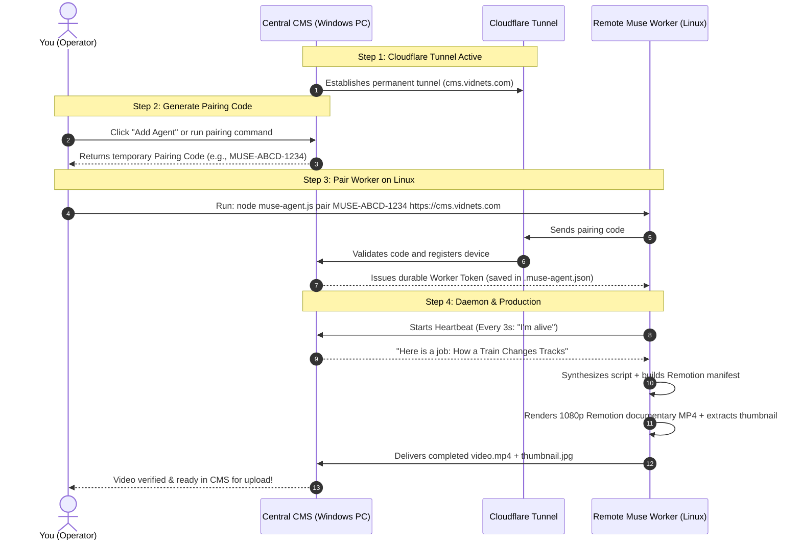

# Vidzeo Muse Production Workflow Guide
### The Plain-English Complete Manual: From Setup & Pairing to 1080p Remotion Video Production

---

## 1. What is This System? (The Big Picture)

Think of this system like a **film production company**:

```
+-------------------------------------------------------------+
|                     CENTRAL CMS                             |
|              (The Director & Film Studio)                   |
|                                                             |
|  - Manages your 7 YouTube Channels                          |
|  - Researches competitor videos & writes title packages     |
|  - Dispatches production jobs                               |
|  - Receives completed videos and uploads them to YouTube   |
+------------------------------+------------------------------+
                               |
                               | (Secure Cloudflare Tunnel)
                               | https://cms.vidnets.com
                               v
+-------------------------------------------------------------+
|                  REMOTE MUSE WORKER                         |
|             (The Heavy-Lifting Factory)                     |
|                                                             |
|  - Runs on a remote Linux VM / cloud server                 |
|  - Writes the full documentary narration script             |
|  - Builds the scene-by-scene editing manifest               |
|  - Renders 1080p documentary video using Remotion (React)   |
|  - Animates maps, blueprints, word highlights, & SFX        |
|  - Sends finished MP4 video + thumbnail back to CMS         |
+-------------------------------------------------------------+
```

### Why don't we do everything on one computer?
Rendering full 1080p documentary videos with animations, maps, motion graphics, audio sync, and special effects takes huge amounts of CPU, RAM, and GPU power. 
- If you render on your personal computer, it can slow down your machine, heat up your laptop, and block your workflow.
- By using **Muse Worker Agents**, you can offload all the heavy video rendering to one or more remote Linux servers or cloud VMs.
- Your Central CMS stays lightweight, fast, and free to manage channels and uploads while workers in the cloud do the hard work.

---

## 2. Key Terms Explained in Simple English

| Term | What It Is | Why It Exists |
| :--- | :--- | :--- |
| **Central CMS** | The central software running on port 3210. | Acts as the "master controller". It holds your channel credentials, queue, title research, and manages the whole business. |
| **Muse Worker Agent** | A lightweight background program (`muse-agent.js`) running on a Linux machine. | Acts as the "video editor & writer". It listens for jobs, writes the script, renders the video using Remotion, and sends it back. |
| **Cloudflare Tunnel** | An encrypted, permanent internet connection (`https://cms.vidnets.com`). | Lets remote Linux workers talk to your Central CMS from anywhere in the world without exposing your home IP address or dealing with complicated router port-forwarding. |
| **Pairing Code** | A short, one-time temporary code (like `MUSE-8A2F-9D1B`). | Valid for only 15 minutes. It is like an invitation card you type into the remote worker so it can introduce itself to the CMS. |
| **Worker Token** | A secret cryptographic keycard stored locally on the worker. | After the pairing code is accepted, CMS gives the worker this secret key. The worker saves it in `.muse-agent.json`. The raw key is never shown on screen, and CMS only keeps a secure fingerprint (SHA-256 hash). |
| **Heartbeat** | A quick check-in message sent every 3 seconds by the worker. | Tells the CMS: *"I am online, healthy, and ready to accept a video rendering job."* |
| **Semantic Manifest** | A structured blueprint of the documentary video. | Connects each sentence of the script to a specific visual template: maps for travel routes, blueprints for mechanics, word highlights for quotes, stat cards for speeds, and SFX cues. |
| **Remotion** | A code-based video engine that renders video using React. | Instead of manual video editing in Premiere or basic solid-color clips, Remotion programmatically generates professional 1080p motion graphics, smooth transitions, camera zooms, and audio overlays. |

---

## 3. The 3 Main Steps: How to Connect & Run



---

## 4. Step-by-Step Walkthrough

### Part A: On Your Central PC (CMS)

#### 1. Ensure CMS & Tunnel Are Running
Open PowerShell in the CMS directory and start the production service:
```powershell
powershell -NoProfile -ExecutionPolicy Bypass -File "Management/YT CMS/start-production.ps1"
```
The CMS will start on `http://127.0.0.1:3210` and automatically connect the permanent Cloudflare Tunnel at **`https://cms.vidnets.com`**.

#### 2. Generate a Pairing Code
- **Via the CMS Web UI:** Open `http://localhost:3210` in your browser. Go to **Settings** or **Agents**, click **Connect New Agent**, and copy the 12-character pairing code.
- **Via Command Line:** You can also generate a code directly:
  ```powershell
  node -e "const { createPairing } = require('./Management/YT CMS/lib/museAgents'); console.log(createPairing({ name: 'Primary Muse Worker' }))"
  ```
  *Example Output:* `{ code: 'MUSE-7K2P-9M4Q', expiresAt: '...' }`

---

### Part B: On Your Remote Linux Machine (The Worker)

Log into your Linux VPS or VM terminal (via SSH).

#### 1. Clone or Pull the Latest Repository
```bash
# If cloning for the first time:
git clone https://github.com/armughan-zeb/M2l.git
cd M2l

# If you already cloned it before:
cd M2l
git pull origin main
```

#### 2. Run the Linux Setup Script
This script checks Node.js, installs FFmpeg, configures Linux Chromium sandbox packages needed by Remotion, and installs all npm dependencies:
```bash
bash setup-linux.sh
```

#### 3. Pair the Worker to Your CMS
Run the `pair` command using the pairing code you generated in Part A:
```bash
node muse-agent.js pair MUSE-7K2P-9M4Q https://cms.vidnets.com
```
*What happens:*
- The worker securely talks to `https://cms.vidnets.com/api/muse/agents/pair`.
- CMS accepts the code and issues a unique permanent token.
- The token is encrypted and saved into `.muse-agent.json`.
- The worker is now officially paired as **Primary Muse Worker**!

#### 4. Verify System Health (Doctor Check)
Run the diagnostic doctor to confirm all systems are ready:
```bash
node muse-agent.js doctor
```
You should see:
```text
PASS  Node.js: v20.x+
PASS  Worker credential: Stored in .muse-agent.json
PASS  CMS reachable: https://cms.vidnets.com
PASS  Work folder: ...
PASS  FFprobe: ffprobe
PASS  FFmpeg: ffmpeg
PASS  Remotion Engine: Native Remotion documentary engine active (Maps, Word Highlights, Blueprints, SFX)
PASS  Thumbnail adapter: FFmpeg frame extraction from finished master
All blocking checks passed.
```

#### 5. Start the Worker Daemon
To run interactively in your terminal:
```bash
node muse-agent.js start
```

Or run it in the background as a systemd service (so it keeps running even if you close SSH):
```bash
# Enable and start the system service
sudo systemctl enable --now vidzeo-muse.service

# To check live logs at any time:
journalctl -u vidzeo-muse.service -f
```

---

## 5. What Happens During a Production Job?

Once your worker daemon is running, it watches the CMS queue. Here is the exact lifecycle of a job from start to finish:

```
[ CMS Queue ] ---> Dispatches Job ("How a Train Changes Tracks")
       |
       v
[ Worker Claims Job ] (Status: 5%)
       |
       v
[ Step 1: Script Writing ] (Status: 15%)
  • Synthesizes complete documentary narration (150 words/minute).
  • Follows channel style, tone, and factual grounding rules.
       |
       v
[ Step 2: Semantic Manifest Assembly ] (Status: 30%)
  • Breaks script into fast-paced 4-8 second visual scenes.
  • Sentence has routes/geography?   -> AnimatedMap with route lines & map_pulse SFX.
  • Sentence has speeds/metrics?     -> StatCard with counter & sub_boom SFX.
  • Sentence has machinery/rails?    -> TechnicalBlueprint with DWG callouts & marker SFX.
  • Sentence has accident/records?   -> DeclassifiedDocument with stamp animation.
  • Sentence has spoken key quotes?  -> WordHighlighter synchronized to words.
  • Cycles camera movements (slow push, dynamic zoom, whip pan).
       |
       v
[ Step 3: Pure Remotion 1080p Video Render ] (Status: 30% to 92%)
  • Remotion Bundler compiles React components & motion graphics.
  • Remotion Renderer uses headless Chromium to render every frame at 1920x1080 30fps.
  • Applies film grain, vignette, audio mixing, and SFX cues.
       |
       v
[ Step 4: Thumbnail Extraction ] (Status: 95%)
  • High-impact 16:9 thumbnail frame extracted from the finished master.
       |
       v
[ Step 5: Artifact Delivery to CMS ] (Status: 100%)
  • Worker streams video.mp4 and thumbnail.jpg back to CMS.
  • CMS validates duration, 1080p resolution, audio integrity, and file size (>1MB).
  • Job is marked COMPLETE and queued for YouTube upload via UploadIT!
```

---

## 6. Worker Commands Quick Reference

All commands are run inside the `M2l` folder on your Linux machine:

| Command | What It Does |
| :--- | :--- |
| `node muse-agent.js doctor` | Runs a complete health check on Node, FFmpeg, Remotion, and CMS connection. |
| `node muse-agent.js status` | Shows current pairing status, registered agent name, and active job (if any). |
| `node muse-agent.js start` | Starts the worker loop in the current terminal window. |
| `node muse-agent.js claim` | Manually claims the next pending job from the CMS. |
| `node muse-agent.js deliver` | Delivers the finished video and thumbnail from the work folder. |
| `node muse-agent.js fail "reason"` | Reports an error and releases the active job. |
| `node muse-agent.js unpair` | Removes the local token and unpairs the machine. |

---

## 7. Frequently Asked Questions & Troubleshooting

#### Q1: What happens if my home IP address changes or my router restarts?
**Nothing breaks.** The Cloudflare Tunnel token keeps the permanent domain `https://cms.vidnets.com` connected to your CMS regardless of your home IP address. The remote worker will automatically reconnect within seconds.

#### Q2: What if the worker says `Remotion packages not installed`?
Simply run `bash setup-linux.sh` or run `npm install` inside the `M2l` directory. This installs `@remotion/bundler`, `@remotion/renderer`, `@remotion/player`, React, and Remotion.

#### Q3: How do I know if my worker is connected?
1. On Linux: run `node muse-agent.js status`. It will say `Connected to https://cms.vidnets.com`.
2. On your Central PC: open `http://localhost:3210/boost`. You will see **Primary Muse Worker** listed with a green **Connected** badge and live heartbeat timestamp.

#### Q4: Is any video rendered with FFmpeg solid bars?
**No.** All fallback FFmpeg modes have been completely deleted from the codebase. Every video is rendered through the pure Remotion Documentary Engine with real animated maps, blueprints, typography highlights, and synchronized sound design.
