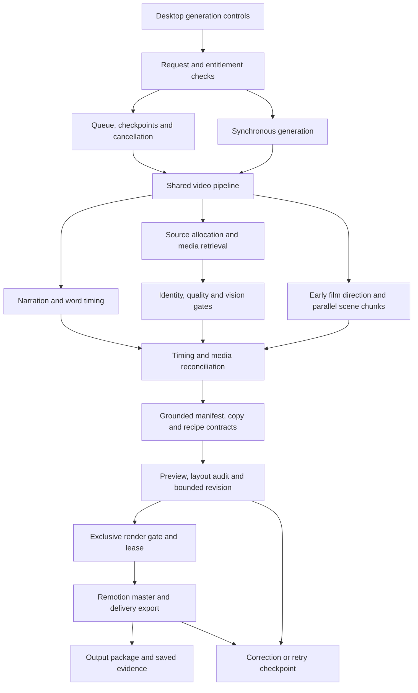

# Vidzeo full-system audit

**Post-audit implementation:** See [audit hardening changes](<C:/Users/user/Documents/Side Projects/Vidzeo Local/Vidzeo App/docs/AUDIT_HARDENING_2026-10-05.md>) for subsequent source fixes, build evidence and open release gates. The findings below record the state at the original audit.

**Audit date:** October 5, 2026  
**Decision:** Suitable for supervised development and trial exports. **Not approved for unattended commercial production.**

## 1. Executive report

The application has a substantial documentary engine: parallel LLM direction, niche profiles, verified media retrieval, a declarative composition language, specialist Remotion graphics, captions, sound cues, checkpoints and serialized rendering. It is capable of producing a usable video. The evidence does not establish consistent, automatic quality across niches or reliable completion of every generation.

The most important findings are:

1. **Commercial access control is bypassed by the backend for unauthenticated localhost requests.** The desktop's distribution restrictions do not resolve this backend behavior.
2. **The latest one-minute automatic generation failed.** The delivered video required curated media and manifest repair outside the automatic generation flow.
3. **Missing-media recovery is inconsistent.** A generated raster fallback can reach an image renderer; another path replaces it with a nearly empty background. Neither guarantees a useful explanatory scene.
4. **Three advertised image treatments cannot reach their distinct rendering branches.** This directly reduces visual variety even when the director requests different treatments.
5. **Current source, the running backend and release evidence are not synchronized.** The documented installer is absent, and recent Python changes postdate the running process.
6. **Budgets and cancellation require further end-to-end verification.** Individual bounded calls and a queue watchdog exist, but waiting on the Python render gate has no deadline of its own, and timed-out executor tasks are not forcibly terminated.

“Ready” in the health endpoint means the service can operate. It does not mean a film passed retrieval, rendering, factual grounding and artistic review.

## 2. Audit method and limits

This audit reviewed the principal application entry points, director, component routing, media coordination, budgets, queue, captions, sound, authentication, billing telemetry and packaging declarations. It also inspected preserved generation reports and the latest film's contact sheet, and performed read-only HTTP status checks.

**No source fixes, paid generation, new render, dependency installation or regression suite were performed during this audit.** Only this report and a sanitized evidence snapshot were created. Historical test results are identified as historical, rather than presented as freshly passing.

This is an architecture and evidence audit, not a claim that every line or every possible path has been executed. The main Python application alone is 23,013 lines; the director is 5,929 lines, YouTube pipeline 7,245 lines and desktop renderer 6,742 lines. The repository contains 141 Python test modules, which is a coverage surface rather than a passing-test count.

External Polar/Supabase dashboards, the separate website repository, live subscription changes, fresh operating-system installation, updater publication and third-party service availability were not independently audited here. No credentials are included in the report or snapshot.

## 3. Runtime and evidence snapshot

| Check | Observed result | Interpretation |
| --- | --- | --- |
| Local status endpoint | HTTP 200, `ready: true` | Backend responds; this is not output certification. |
| Protected queue status without Authorization header | HTTP 200 | Consistent with the confirmed localhost access bypass. |
| Queue | Two preparation workers configured; zero active jobs; eight completed and two paused history entries | Historical completed entries do not establish current quality. Paused jobs remain recoverable. |
| Render exclusivity | Python semaphore plus a cross-process localhost port lease | Two preparation workers do not mean two simultaneous video renders. |
| Runtime build marker | `2026-09-17-media-contract-v7` | Too coarse/stale to identify the exact audited source revision. |
| Bundled font declarations | 35 declared font files, all present | Asset presence verified; every font/style combination was not rendered anew. |
| Documented installer | `dist/Vidnets v1.exe` absent at audit time | Historical packaging claims cannot certify a current distributable artifact. |

Machine-readable evidence: [evidence snapshot](<C:/Users/user/Documents/Side Projects/Vidzeo Local/Vidzeo App/artifacts/full_system_audit_20261005/evidence-snapshot.json>).

### Most recent one-minute documentary

| Item | Result |
| --- | --- |
| Initial automatic `/api/generate` request | HTTP 409 after **994.62 seconds**, no delivered video |
| Request validity | Audit runner submitted nested `config`; endpoint expects flat settings. The runner was corrected, but a fresh full API pass was not performed afterward. |
| Failed manifest | 19 scenes; seven scene media paths point to `graphic_fallback` assets, including six SmartImage scenes |
| Delivered film | Curated repair; 60.000 seconds, 1280×720, H.264/AAC |
| Rendering path | Production Remotion composition invoked from the repair renderer, followed by pitch-preserving delivery tempo adjustment |
| Explanatory graphics coverage | **33.06%** in the repaired manifest; this does not prove automatic 30% coverage |
| Sound | Four planned SFX assets; narration present; peak measured at −6.6 dB |
| Structural checks | Full decode passed; all saved asset paths exist; 34 sampled preview frames reported zero text overflow before the last cue adjustment |
| Final review | No final LLM quality certification; audio was not subjected to a complete listening review |
| Tracked OpenRouter generation charges | **$0.105339855**, 152 priced generation records |
| Account-key usage delta | **$0.10798386**; not identical to the request ledger and not treated as exact job attribution |

The failed request is not a valid benchmark of the nested settings it intended to apply. It remains valid evidence that the actual run did not deliver an automatic film. Likewise, the repaired video's decode success proves technical decodability, not premium editing or unattended reliability.

Sources: [latest documentary report](<C:/Users/user/Documents/Side Projects/Vidzeo Local/Vidzeo App/artifacts/cooper_one_minute_20261005/README.md>), [failed API response](<C:/Users/user/Documents/Side Projects/Vidzeo Local/Vidzeo App/artifacts/cooper_one_minute_20261005/response.json>), [final validation](<C:/Users/user/Documents/Side Projects/Vidzeo Local/Vidzeo App/artifacts/cooper_one_minute_20261005/final-validation.json>), [billing receipt](<C:/Users/user/Documents/Side Projects/Vidzeo Local/Vidzeo App/artifacts/cooper_one_minute_20261005/cost-report.json>).

## 4. Architecture and connected paths

Important ownership boundaries:

- [Main application coordinator](<C:/Users/user/Documents/Side Projects/Vidzeo Local/Vidzeo App/server/app.py:19796>) normalizes settings, establishes the editing profile, prepares concurrent work and joins the final export.
- [Queue manager](<C:/Users/user/Documents/Side Projects/Vidzeo Local/Vidzeo App/server/services/queue_manager.py:186>) owns durable states, preparation concurrency, cancellation and recovery.
- [LLM director](<C:/Users/user/Documents/Side Projects/Vidzeo Local/Vidzeo App/server/services/editorial_director/director.py:3627>) owns art direction, scene batches, validated motion and approved copy. It can author new arrangements through a bounded recipe language; it does not generate and execute arbitrary React code.
- [Media coordinator](<C:/Users/user/Documents/Side Projects/Vidzeo Local/Vidzeo App/server/services/media_resolution_coordinator.py:1768>) combines source results with semantic verification and explicit degraded states.
- [Scene registry](<C:/Users/user/Documents/Side Projects/Vidzeo Local/Vidzeo App/src/remotion/engine/SceneRegistry.js:130>) routes directed charts, timelines, comparisons, diagrams, maps and other specialists. Compatibility paths still exist.
- [Composition](<C:/Users/user/Documents/Side Projects/Vidzeo Local/Vidzeo App/src/remotion/DocumentaryComposition.jsx:448>) combines media, graphics, approved text, captions, transitions and sound on the Remotion frame clock.
- [Native render policy](<C:/Users/user/Documents/Side Projects/Vidzeo Local/Vidzeo App/server/services/native_render_policy.py:1230>) governs preflight, pixel review, creative correction, export and retryability.

The library and recipe system are a reasonable basis for adaptive editing. More templates alone will not resolve inconsistent routing, weak media or contradictory recovery paths.

## 5. Prioritized findings

Priority meanings: **P0** blocks a paid distribution release; **P1** materially affects generation reliability or output quality; **P2** is a correctness, coverage or observability gap. “Risk” denotes a code-supported concern that was not reproduced as a fresh failure during this audit.

### F01 — P0: localhost requests receive active Pro access without authentication

**Confirmed.** The backend returns a synthetic active Pro user when the request has no bearer token and originates from loopback. The branch has no development-mode or packaged-mode condition. Protected queue status returned HTTP 200 without an Authorization header during this audit.

The desktop restricts local distribution mode in packaged builds, but a separate HTTP caller can reach the backend directly. CORS does not protect against a local command-line caller. This is a commercial entitlement enforcement defect; the audit does not claim remote internet access or account compromise.

**Required closure:** Gate local development access behind an explicit development-only setting; packaged paid distribution must require validated identity and entitlement at the backend. Verify unauthenticated protected reads and writes return 401, inactive users return 403 and active users succeed.

Evidence: [backend access branch](<C:/Users/user/Documents/Side Projects/Vidzeo Local/Vidzeo App/server/app.py:418>), [active-access decorator](<C:/Users/user/Documents/Side Projects/Vidzeo Local/Vidzeo App/server/app.py:531>), [desktop distribution guard](<C:/Users/user/Documents/Side Projects/Vidzeo Local/Vidzeo App/main.js:1559>).

### F02 — P1: latest full automatic generation still required manual intervention

**Confirmed.** The latest one-minute crime run failed at its quality gate. The final export required primary-source asset curation, corrected scene grouping and manifest repair. The repaired video contains no YouTube clips and repeatedly uses the composite sketch. That does not satisfy proof of diverse automatic footage retrieval.

Rejecting unsuitable footage is appropriate. The gap is the system's ability to automatically obtain suitable replacements or produce a meaningful, grounded alternative within its budget.

**Required closure:** Repeat a correctly shaped full API request after loading the current fixes. Preserve source selection, candidate rejection, actual used media, timing, revisions and costs per job. Complete independent automatic trials for crime, sports, travel, biography and science/technology before claiming broad niche reliability.

Evidence: [failed run and curated repair record](<C:/Users/user/Documents/Side Projects/Vidzeo Local/Vidzeo App/artifacts/cooper_one_minute_20261005/README.md>).

### F03 — P1: emergency recovery is not a dependable explanatory graphic

**Confirmed.** The application creates emergency raster plates, including generic rings/lines for non-sports cases. The shared media layer recognizes fallback paths and replaces them with a neutral canvas. SmartImage independently handles missing/failed files but does not recognize the same fallback-path classification. A successfully loaded fallback PNG can therefore remain the scene's actual image.

The neutral recovery component supplies a background only. If no grounded specialist survives above it, the viewer gets an empty-looking scene. Seven failed-manifest scene media paths used fallback assets. The application's comments also say missing media should fail closed while its defaults enable emergency media and grounded graphic recovery.

**Required closure:** Use one explicit recovery contract across resolution, manifest validation and every renderer. A recovered explanatory scene must contain supported information, approved copy where available and a timed presentation. Mark it degraded. Keep unresolved and intentionally quiet scenes distinct from accepted real media.

Evidence: [raster fallback creator](<C:/Users/user/Documents/Side Projects/Vidzeo Local/Vidzeo App/server/app.py:2528>), [defaults](<C:/Users/user/Documents/Side Projects/Vidzeo Local/Vidzeo App/server/app.py:19830>), [shared media handling](<C:/Users/user/Documents/Side Projects/Vidzeo Local/Vidzeo App/src/remotion/DocumentaryComposition.jsx:105>), [SmartImage](<C:/Users/user/Documents/Side Projects/Vidzeo Local/Vidzeo App/src/remotion/components/SmartImage.jsx:66>), [neutral recovery canvas](<C:/Users/user/Documents/Side Projects/Vidzeo Local/Vidzeo App/src/remotion/components/MissingSceneMotionGraphic.jsx>).

### F04 — P1: distinct image treatments are unreachable

**Confirmed.** SmartImage's early full-bleed branch includes `editorial_crop`, `framed_print` and `archival_polaroid`. It returns before the later dedicated branches for those variants can run. Different director selections consequently produce the same layout family.

**Required closure:** Restore distinct rendering ownership or remove unavailable styles from the director capability catalog. Render opening, hold and exit samples for each advertised variant and compare the actual layouts.

Evidence: [early branch](<C:/Users/user/Documents/Side Projects/Vidzeo Local/Vidzeo App/src/remotion/components/SmartImage.jsx:110>), dedicated branches at [editorial crop](<C:/Users/user/Documents/Side Projects/Vidzeo Local/Vidzeo App/src/remotion/components/SmartImage.jsx:197>), [framed print](<C:/Users/user/Documents/Side Projects/Vidzeo Local/Vidzeo App/src/remotion/components/SmartImage.jsx:245>) and [polaroid](<C:/Users/user/Documents/Side Projects/Vidzeo Local/Vidzeo App/src/remotion/components/SmartImage.jsx:413>).

### F05 — P1: deadline and cancellation guarantees are incomplete

**Confirmed behavior, with an unbounded-wait risk.** The Python render gate waits repeatedly with no elapsed deadline; cancellation only helps callers that pass a cancellation context. The synchronous API invokes the pipeline without one. The JavaScript renderer adds a separate bounded port-lease wait, but that does not bound the earlier Python semaphore wait.

The director bounds its caller's wait, then shuts down executors with `wait=False`. Running network calls are not terminated by cancelling pending futures. The generic OpenRouter client defaults to a 360-second request allowance and a 1,500-second total allowance unless callers override them. These defaults do not prove every actual director call uses those allowances, but they make complete budget propagation important.

The main render loop does have stall detection and a hard extension ceiling; it should not be described as entirely unbounded. The 994.62-second API observation alone is also insufficient to identify which stage exceeded a shared budget, because the test settings were nested incorrectly.

**Required closure:** Apply one remaining-budget contract to render-gate acquisition, provider calls, retries, render grace periods and direct API cancellation. Record late tasks separately and prevent them from writing state after a job finishes. Verify slow, failed and cancelled jobs quiesce within the configured wall budget.

Evidence: [Python gate](<C:/Users/user/Documents/Side Projects/Vidzeo Local/Vidzeo App/server/services/remotion_render_gate.py:12>), [synchronous API](<C:/Users/user/Documents/Side Projects/Vidzeo Local/Vidzeo App/server/app.py:21319>), [director bounded call](<C:/Users/user/Documents/Side Projects/Vidzeo Local/Vidzeo App/server/services/editorial_director/director.py:3962>), [OpenRouter defaults](<C:/Users/user/Documents/Side Projects/Vidzeo Local/Vidzeo App/server/services/openrouter_llm.py:258>), [render extension ceiling](<C:/Users/user/Documents/Side Projects/Vidzeo Local/Vidzeo App/server/services/native_render_policy.py:1336>).

### F06 — P1: numeric grounding is incomplete in the new metric renderer

**Confirmed by static inspection.** AdaptiveMetricGrid recognizes digits and individual number words only through twenty. It does not parse composite spoken numbers. For example, its word matcher extracts `twenty` from `twenty-six`, so a correct value of 26 is rejected while a mismatched value of 20 can satisfy that renderer's equality check. `eight hundred` is treated as 8. Earlier server validation may reject some such payloads; this is a defect in the renderer's independent grounding check, not proof that every bad value passes the whole pipeline.

Metric ink is also hardcoded near-white rather than selected for the current canvas. A light visual grammar needs a separate contrast check.

**Required closure:** Use the same canonical parsed numeric evidence in the server and renderer, supporting compound numbers, magnitudes, units and qualifiers. Do not turn unsupported parsing into silently missing facts. Verify the component on dark and light canvases.

Evidence: [metric parsing and rendering](<C:/Users/user/Documents/Side Projects/Vidzeo Local/Vidzeo App/src/remotion/components/AdaptiveMetricGrid.jsx:5>).

### F07 — P1: current runtime and release proof lag the source

**Confirmed.** The running Python process was started before the latest scene-splitting changes. The earlier restart attempt was blocked by automatic approval review, which supplied no specific reason. No restart was attempted during this audit. Remotion changes were bundled for the repaired render, but that does not reload Python modules.

The older release review reports an installer and passing suites. The installer path is now absent, and subsequent source changes have no corresponding fresh package proof. The source may be repairable and the prior build may have existed; neither establishes a current releasable binary.

**Required closure:** Perform a permitted clean restart, expose a source/build fingerprint, rerun the relevant checks and create a new installer. Verify its bundled sources, credentials scan, writable data paths and clean-machine bootstrap.

Evidence: [historical release report](<C:/Users/user/Documents/Side Projects/Vidzeo Local/Vidzeo App/docs/FINAL_RELEASE_REVIEW.md>), [latest restart limitation](<C:/Users/user/Documents/Side Projects/Vidzeo Local/Vidzeo App/artifacts/cooper_one_minute_20261005/README.md>), [current snapshot](<C:/Users/user/Documents/Side Projects/Vidzeo Local/Vidzeo App/artifacts/full_system_audit_20261005/evidence-snapshot.json>).

### F08 — P2: malformed configuration is silently accepted

**Confirmed by the latest runner.** The generation endpoint expects flat settings. A nested `config` request reached the pipeline while requested voice, captions and budgets were ignored. This originated in the audit runner, not the desktop's normal flat payload, but the API did not report the shape error.

**Required closure:** Publish and enforce a versioned request schema. Reject unexpected nesting or explicitly normalize it. Return a sanitized effective configuration in the job package so callers can verify what the backend actually used.

Evidence: [endpoint](<C:/Users/user/Documents/Side Projects/Vidzeo Local/Vidzeo App/server/app.py:21319>), [runner correction record](<C:/Users/user/Documents/Side Projects/Vidzeo Local/Vidzeo App/artifacts/cooper_one_minute_20261005/README.md>).

### F09 — P2: other style controls are ignored or overridden

**Confirmed.** A truthy `panel_style: 'none'` overrides the `impact_slab` variant before falling back to `hero_type`. Selecting the impact variant therefore does not always select its expected highlight treatment. VisualTexture intentionally returns nothing for paper, halftone, film grain and other named options. Suppressing damaging textures is reasonable, but advertising unavailable controls produces misleading direction.

**Required closure:** Define precedence for variant, panel and explicit no-panel settings. Advertise only real runtime capabilities; keep clean media as a valid creative choice. Validate the director's selected and actually rendered styles in diagnostics.

Evidence: [kinetic style resolution](<C:/Users/user/Documents/Side Projects/Vidzeo Local/Vidzeo App/src/remotion/components/KineticText.jsx:136>), [texture suppression](<C:/Users/user/Documents/Side Projects/Vidzeo Local/Vidzeo App/src/remotion/engine/StyleEngine.js:410>).

### F10 — P2: saved repaired counter timing still differs from narration

**Confirmed in the repaired artifact.** The 800-suspect scene starts at master time 38.7 seconds. Its data motion cue starts at local 0.15 seconds, while the timed word `800` begins at 42.76 seconds, local 4.06 seconds. The number reveal leads the spoken value by approximately 3.91 master seconds. Its copy window is aligned later, showing that the two cue paths can diverge.

This is an artifact-level timing finding, not proof that every automatically generated counter is misaligned. The cash-counter cue was separately corrected and should not be grouped with this finding.

**Required closure:** Resolve graphic motion, text emphasis and SFX from one narration anchor after final timing reconciliation. Permit deliberate previews only as an explicit editorial decision, not an accidental default cue.

Evidence: [repaired manifest, scene 9](<C:/Users/user/Documents/Side Projects/Vidzeo Local/Vidzeo App/artifacts/cooper_one_minute_20261005/repaired-manifest.json>), [counter cue handling](<C:/Users/user/Documents/Side Projects/Vidzeo Local/Vidzeo App/src/remotion/components/AdaptiveStat.jsx:22>).

### F11 — P2: legacy templates still contain invented filler

**Confirmed implementation; production reachability needs a focused path audit.** The legacy metric grid includes `THE NUMBERS`, a default explanatory sentence, an invented `DATASET / ...` identifier and an oscillating width. Other legacy templates draw schematic routes with default start/destination labels. The new directed metric-grid path avoids that particular legacy component, but saved plans and compatibility renderers remain part of the application.

The presence of legacy code does not establish that the current repaired video used it. It means “all templates are grounded and production-safe” is not supported yet.

**Required closure:** Identify every production-callable legacy template, remove invented evidence marks and require supported payloads. Maintain a capability matrix with real rendered samples and rejection behavior for unsupported IDs.

Evidence: [legacy metric grid](<C:/Users/user/Documents/Side Projects/Vidzeo Local/Vidzeo App/src/remotion/templates.jsx:530>), [legacy route](<C:/Users/user/Documents/Side Projects/Vidzeo Local/Vidzeo App/src/remotion/templates.jsx:538>), [directed metric routing](<C:/Users/user/Documents/Side Projects/Vidzeo Local/Vidzeo App/src/remotion/engine/SceneRegistry.js:149>).

### F12 — P2: per-video billing cannot be reliably attributed across concurrent jobs

**Confirmed.** Billing telemetry is opt-in and writes to one environment-selected ledger. Rows contain generation IDs, model and operation but no application job/run ID. Two preparation workers can overlap provider calls, and timed-out calls may finish later. A shared ledger's total is therefore not automatically one video's cost.

**Required closure:** Add job, attempt and operation correlation to each provider record; persist a job-local receipt with priced, unpriced and late records. Keep provider-account usage deltas separate from attributable generation charges. Continue excluding prompts and credentials.

Evidence: [usage ledger](<C:/Users/user/Documents/Side Projects/Vidzeo Local/Vidzeo App/server/services/openrouter_usage.py:13>).

### F13 — P2: desktop secret storage can fall back to plaintext

**Confirmed conditional behavior.** When Electron safeStorage is unavailable, the protected JSON helper returns `protected: false` with the original payload. Auth sessions and secret settings share that helper. The audit did not inspect actual secret contents and does not claim they are currently plaintext.

**Required closure:** Make this condition explicit and restrict sensitive persistence, or supply a supported secure-store recovery policy. Verify the distribution platform's behavior without exposing credentials in diagnostics.

Evidence: [protected store helper](<C:/Users/user/Documents/Side Projects/Vidzeo Local/Vidzeo App/main.js:1389>).

## 6. Requirements coverage

| Requirement | Current implementation | Audit assessment |
| --- | --- | --- |
| Universal niche-aware editing | Shared profiles and director vocabulary for crime, sports, travel, biography, politics, finance, science, technology, gaming, history, royal, automotive, aviation, maritime, engineering and other categories | Present; complete automatic exports across these niches are not established. |
| Crime theme | Charcoal, warm-white copy and restrained red vocabulary exist | Theme availability is established; consistent retrieval, hierarchy and final aesthetics need new automatic trials. |
| New layouts beyond a fixed catalog | Validated declarative recipes combine timed semantic, geometric and media layers | Implemented; this is new composition within an authored language, not arbitrary code generation. |
| All suitable templates reachable | Specialist routing exists | Partial: unreachable image treatments and unsafe legacy behavior remain. “Use all templates” should mean availability and correct selection, not forcing every template into every film. |
| Approximately 30% meaningful graphics | Pipeline default 0.30; director and manifest audits | Repaired film 33.06%; duration-based automatic coverage across scripts still needs proof. Decorative lines/captions must not count as explanations. |
| Early high-retention pacing | Opening shot counts, max hold guidance and director instructions | Implemented intent; no measured viewer-retention proof. A three-second rhythm is a creative heuristic, not an attention-span guarantee. |
| Accurate names, facts and figures | Script-grounded copy and semantic/data contracts | Present; numeric parser and timing defects remain. Grounding to narration does not independently fact-check the narration. |
| Tight text panels and placement | Fit utilities, font readiness, safe-region placement, approved emphasis | Improvements exist; style precedence, light-canvas contrast and all-layout coverage still need verification. |
| Maps, satellite and globe variety | Natural Earth vector map, satellite renderer and textured globe; bounded eased movement guidance | Connected. This audit cannot certify shake-free animation from still images. No fresh motion review was run. |
| Image framing, masks, portraits | Image variants, recipe masks, montages, optional local cutout worker | Available; three image branches are unreachable, cutout success is conditional on model/asset availability. |
| HD YouTube with distant reusable moments | Pools, timestamp selection, normalization, source quality and vision gates | Implemented. Latest repaired film used no YouTube; successful diverse automatic retrieval remains a release gate. |
| Web and stock alternatives | Niche-sensitive allocations and cross-source retrieval | Connected; primary evidence search and degraded-state semantics remain weak in the latest failed run. Stock context must not impersonate a named person/event. |
| Parallel vision and LLM work | Bounded workers, scene chunks and concurrent source work | Present; no new load or provider-outage verification during this audit. |
| Captions rendered in Remotion | UI controls, bundled fonts/styles, timed words and collision suppression | Present. Copy/graphic windows can suppress captions broadly; review full caption continuity in automatic exports. |
| Proper SFX | Local catalog, scene-local Sequences, transient timing, volume/fades | Present; latest repaired film has four cues. File existence and metadata do not establish audibility, appropriateness or final mix quality. |
| Transitions and color grading | Frame-based transition components and media grading controls | Connected; tasteful selection and variety require full-video review, not a template-count claim. |
| One export at a time | Shared Python gate and cross-process renderer lease | Good structural protection. Bounded gate waiting remains a gap. |
| Retry and checkpoint resume | Durable paused states, retry buttons, saved audio/media/plan | Connected; two current jobs are paused. A retry can encounter the same unresolved quality issue. |
| Additional TTS voice characters | Model voice catalogs and frontend selection | Present for published/bundled English catalogs. The frontend explicitly filters English locales; it does not expose every multilingual character. |
| Jev skipped | Optional decisions disabled by default in the recent change and current run | Consistent with the request; new Python source still needs a permitted restart. |
| Long documentaries | Adaptive planning waves and longer delivery allowances | Implemented budgeting, not demonstrated long-form reliability or memory stability. |
| Cost and preserved logs | Saved job packages, billing ledger and test evidence | Useful foundation; automatic per-job provider attribution is incomplete. |
| Lifetime Pro and subscriber preservation | Lifetime plan key recognized in app entitlement normalization | Live Polar/website prices, codes, renewal cancellation and webhook reconciliation were not verified in this audit. |

## 7. Planning speed and reliability assessment

The current director's default is **one scene per chunk with four workers**, rather than the two-scene default described in older architecture prose. Its adaptive allowance is:

`max(base 90s, art 20s + (scene 55s + composition 40s) × waves + repair 10s + 5s)`

The default cap is 3,600 seconds. For 19 scenes, five waves produce a **510-second planning allowance**. For four scenes, one wave permits 130 seconds. These are maximum allowances, not measured runtimes, and the work can overlap retrieval/audio.

That is compatible with the user's later request for adaptive long-film planning. It should not be marketed as a universal 90-second result. More important than adding workers is keeping the prompt compact, reusing validated evidence, preserving completed chunks and avoiding repeated expensive verification of the same asset.

The queue watchdog, isolated YouTube branch work, atomic video publication, provider timeouts and render stall detection are valuable reliability mechanisms. Their presence does not prove every direct, queued, resumed and editor path obeys the same job deadline. That requires targeted failure testing after the runtime is synchronized.

## 8. Evidence quality and remaining validation

Earlier reports record substantial regression coverage, director fixtures, an Apollo export and a three-scene crime smoke test. Those are useful historical evidence. They precede later modifications and do not supersede the latest one-minute automatic failure.

The repaired film's contact sheet shows relevant artifacts, an actual geographical canvas and numeric explanations. It also repeats the same composite sketch and uses sparse graphical layouts. Those frames do not substantiate “better than a human editor,” “every niche looks unique” or “Vox-level production quality.” A sampled near-empty opening frame is not by itself proof of an extended blank scene; motion must be inspected over time.

Remaining validation gates:

1. Backend authentication/entitlement checks under development and paid packaged configurations.
2. Fresh current-source regressions for routing, fallback contracts, numbers, copy, captions, timing, cancellation and render serialization.
3. Correctly shaped, fully automatic one-minute generation with zero manual source or manifest repair.
4. Several independent niche exports with actual relevant media, grounded graphics and source provenance.
5. Opening/reveal/hold/exit motion samples for every advertised component family, including missing-media behavior.
6. Complete video and audio review: contrast, panel size, face/evidence protection, meaningful rhythm, maps, media repetition, captions and SFX.
7. Slow/failing provider tests and cancellation quiescence, including direct API and queued jobs sharing a render gate.
8. A longer export and concurrent preparation run with memory, wall-time and provider-cost records.
9. Current installer, package scan, runtime fingerprint and clean-machine bootstrap.

## 9. Repair order

### First: correctness and release protection

- Close F01's backend entitlement bypass.
- Synchronize source/runtime and record the exact build.
- Unify fallback handling; remove ambiguous “accepted” recovery plates.
- Restore real image-variant routing and canonical numeric grounding.

### Second: one reliable automatic film

- Enforce the request schema and effective settings receipt.
- Bound gate waits and propagate the job deadline/cancellation.
- Improve primary-source/media replacement, preserving relevance over decorative quota-filling.
- Unify narration anchors for graphics, copy and sound.
- Run one complete automatic job and retain the evidence before expanding the trial matrix.

### Third: creative quality and distribution

- Remove unavailable style choices and legacy fake evidence marks.
- Review niche films for purposeful layouts, meaningful changes, footage diversity and audible event-driven SFX.
- Add job-correlated billing and clearly visible degraded/review statuses.
- Build and verify the current installer after the automatic trial matrix passes.

## 10. Final assessment

**The core is implemented, but the system is not finished.** The main remaining work is access control, consistent recovery, truthful routing, numeric/timing correctness, automatic media quality and current release verification. It is usable with supervision; claiming unattended, error-free production or guaranteed editorial excellence would exceed the evidence.

This audit does not prescribe filling every scene with graphics. The required outcome is accurate media, coherent niche direction, grounded explanations, restrained typography and sound that strengthens the narrative—with failures and degraded decisions visible rather than hidden.
