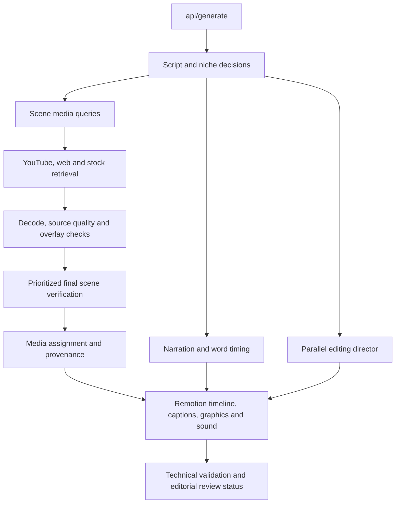

# Vidnets 1.0.7 — media handoff and reliability repair

## Reference application

Compared this app with `C:/Users/user/Documents/Side Projects/Vidzeo CoSystems/Tools/Vidnets Working Folder`.
The main Remotion composition, scene grammar, normal component library and editing rules already match.
Retained those editing paths and the current readable recovery layouts. Did not replace newer settings,
access, voice, queue or visual-safety fixes with the older reference application.
The file/function comparisons are preserved under `artifacts/pipeline_repair_1_0_7/`.

## Repaired flow

## Changes

- The coordinator now reserves the actual YouTube transfer-wave allowance, rather than ending discovery
  before the low-memory worker's finite transfer window. Rendering retains its resource-aware supervision.
- Downloaded quota clips receive a separate, bounded final verification window when their original
  verification deadline expired. This only checks existing local files and respects the shared delivery
  budget. Explicit wrong-entity, event and safety verdicts remain vetoes.
- Initial semantic verification uses three finalists per scene by default, preserving a YouTube slot
  and checking requested footage first. Other candidates remain available for bounded recovery.
  This reduces redundant paid checks without reducing the editing component library.
- Direct clip downloads use the pool renderer's measured camera-motion admission. Actual live-action
  footage is no longer discarded solely because a pan/hold heuristic fired. Static and unusable files
  remain subject to motion, overlay, decode and final pixel checks.
- HD remains preferred. Both source and range downloads can fall back to bounded, labelled 480p.
  Decoded-source validation follows that policy. Authentic archival SD retains its separate exception;
  `VIDZEO_YT_ALLOW_SD_FALLBACK=0` retains HD-only behavior.
- Exhausted format selection does not launch another unbounded `/best` rescue extraction. Both metadata
  passes include their compatible alternatives; failures move to another candidate.
- Product/food names such as Tesla Model 3 and Apple nutrition are no longer classified as businesses
  merely because a brand token occurs in their names. Recognized leagues/teams keep sports context.
- Static branding cannot replace the action described in a scene. Logos remain valid for identity and
  branding narration. This applies through the scene verifier rather than a niche-specific renderer.
- Late retrieval callbacks cannot relabel an active render as "Preparing media". Pause/error messages
  take priority over a stale 100% progress value in the desktop UI.
- Final clip screening no longer writes global caption/blur settings from a concurrent job.
- An 8 GB host now reserves serial transfer waves in the parent even if two workers fit before
  narration and visual analysis load. The child still uses extra workers when RAM is available.
- Direct title-card screening reuses the overlay check's bounded JPEG samples. It no longer opens
  an unrestricted OpenCV video decoder. The footage-only coordinator also uses bounded extraction,
  and source probes limit decoder threads to one.
- Spoken measured counts (for example four downs, ten yards, twenty-six seconds and one hundred
  twenty passengers) reach graphic triggers with complete values and labels. Ordinary prose and
  dates remain excluded. Sentence leads such as “An NFL” are not treated as person names.
- Package and lockfile versions are synchronized. Delivery-folder identity is checked against the final
  packaged build; old portable/editable folders must be refreshed before delivery is marked complete.

## Verification record

See the final test, live-generation and package records in `artifacts/pipeline_repair_1_0_7/`.
Exploratory runs remain preserved, including unsuccessful coverage results; they are not release approval.
Only final frozen-source/package runs may be used as release evidence.

Completion means a usable export exists. Editorial approval remains separate: incorrect source choices,
insufficient graphics or incomplete review must remain visible rather than being relabelled as approval.
No release claims immunity to external provider outages or zero future bugs.

### Test provenance

The broad regression run passed 483 Python tests and 31 JavaScript tests. After the stressed
packaged run exposed the parent/child memory mismatch, 212 focused media tests and 42 text/director
tests passed. These sets overlap; they must not be summed as unique coverage.

Packaged job `313fecaa` completed in 961.2 seconds under concurrent packaging/copy load but used
only one of seven requested scene slots as YouTube footage. It is a failed coverage test, not
an approved sample. The subsequent `final_validation` run uses the corrected transfer allowance
and bounded sampling with packaging/copy work paused. Its final outcome is recorded separately.
