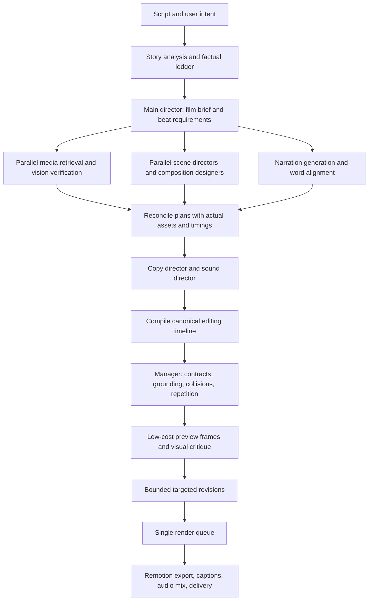

# Vidzeo: complete adaptive Remotion editing system

**Date:** 1 October 2026  
**Status:** implementation plan, not a declaration that every feature is finished  
**Primary output:** 16:9 documentary video; design contracts must also support later aspect-ratio adaptations.

## 1. Product goal

Turn a script into a researched, coherent documentary with original information-led editing. The system must explain the subject visually, maintain attention, preserve factual accuracy, and vary its approach across videos and niches.

“Vox/Vidrush level” is an aesthetic ambition: strong composition, meaningful visual explanations, confident typography, precise timing, and good media. It is not permission to copy branding or a promise that passing technical tests establishes that quality.

The director must decide **what the viewer should understand at each beat**, then choose or design the visual that teaches it. Adding more cards, transitions, or movement is not sufficient.

## 2. Current foundation and observed gaps

The repository already contains an EditingDirector, script analysis, visual DNA, media direction, audio synchronization, sound direction, scene grammar, manager corrections, a deterministic visual critic, a Remotion registry, specialist components, and a declarative recipe renderer. The latest changes added one-scene parallel planning, bounded custom layout passes, editorial type treatments, shared CSS grading, and narrated actor reveals.

The last reviewed sample still showed:

- Ordinary opening footage despite a request for a strong opening.
- A vision result describing a text-bearing infographic as text-free.
- An abstract diagram where the narration asked the viewer to watch a map.
- Sparse explanatory illustrations and predictable compositions.
- Low available memory blocking the main API render, despite a saved valid plan.

These are acceptance failures to resolve. They must not be hidden behind a successful manifest audit or fallback status.

## 3. Architecture and complete lifecycle

Planning begins as soon as the script is available, in parallel with media and narration. Scene drafts declare required assets and visual roles. Final placements and exact frame times are resolved after assets and narration timings arrive. Do not repeatedly restart the whole director when one asset changes.

All generation, manual editing, preview, retry, and export paths must converge on the same versioned timeline and shared render slot.

## 4. LLM roles and responsibilities

| Role | Input | Required output | Forbidden behavior |
|---|---|---|---|
| Story analyst | Full script, niche, audience, duration | Arc, entities, claims, beat boundaries, research needs | Invent facts to make graphics possible |
| Main director | Story arc and evidence ledger | Film brief, visual grammar, opening strategy, pacing, scene objectives | Pick one global template for every scene |
| Media planner | Scene requirements and neighboring beats | Search queries, preferred media types, quantity, shot coverage, exclusions | Search only the broad topic or accept games as documentary footage |
| Vision verifier | Actual selected pixels/clip samples and exact scene context | Subject/action match, readable text boxes, focal regions, quality findings | Treat metadata as visual proof |
| Scene director | Film brief, full arc, scene, neighbors, available assets | Visual role, specialist component, shot list, motion cues, transition intent | Replace an explicit geographical explanation with decorative shapes |
| Composition designer | Approved scene intent, actors, facts, palette, timing | Custom validated layout and element choreography | Invent values, labels, routes, or execute arbitrary code |
| Copy director | Narration, approved claims, timed words, layout | Exact approved headings/emphasis with spans and cue windows | Rebuild text from narration later in the renderer |
| Sound director | Final motion events, narration pauses, music | Selected SFX with semantic event bindings and mix instructions | Add a whoosh to every cut |
| Visual critic | Preview frames, timeline, narration context | Specific visual defects and targeted corrections | Declare quality based only on schema validity |
| Manager/orchestrator | All contracts and critic findings | Accepted plan or bounded scene revisions, honest coverage status | Override specialist intent with generic media-first fallbacks |

These are logical roles. They need not each incur a separate LLM request. Combine lightweight roles when practical; use dedicated calls where they materially improve the output.

## 5. Shared context, chunking, and deadlines

Every scene worker receives the full film summary, ordered scene objectives, genre grammar, approved palette/type rules, opening strategy, its narration, adjacent scenes, relevant factual evidence, relevant assets, and the recent visual signatures it must avoid.

Do not send every image or geographical record to every worker. Keep scene-specific payloads compact, while preserving film-level intent. Use one-scene chunks by default; permit larger chunks only when measured response reliability supports them.

- Use bounded worker pools for planning, vision, and retrieval. Parallelism must respect provider limits, CPU, RAM, and network capacity.
- Allocate deadlines by stage and number of scene waves, not a fixed 90 seconds for every documentary.
- The current budgeting foundation uses approximately 20 seconds for art direction, 55 seconds per scene-planning wave, up to 40 seconds per optional composition wave, 10 seconds for copy repair, and a small grace period. These are configurable starting allocations, not latency guarantees.
- Preserve successful chunks. Retry only failed or rejected scenes within the remaining budget.
- Reserve sufficient time for the primary model before trying fallbacks. Bound the entire fallback chain with one deadline.
- Cancel obsolete work, propagate job cancellation, and prevent timed-out calls from mutating an accepted plan.
- Record provider, model, latency, retries, fallback reason, creative coverage, and composition coverage per scene.
- An unavailable LLM produces a grounded, text-free local treatment and an explicit degraded status. It must not be reported as fully directed.

Measure planning latency separately from media retrieval, voice synthesis, previews, and export. Cache reusable evidence and analysis by content hash without reusing one film's creative plan indiscriminately.

## 6. Canonical contracts

The versioned editing manifest is the source of truth. It must carry:

1. **Film brief:** audience, niche, story arc, palette, typography, grammar, pacing, opening intent.
2. **Evidence ledger:** fact IDs, sources, verified values/units/dates, geographic data, quote provenance, uncertainty.
3. **Scene objective:** exact narration, semantic role, what the viewer should learn, required visual features.
4. **Assets:** source URL/path, quality, selected trim, crop/focal point, rights status, verification tied to the actual asset hash.
5. **Shots:** ordered local frame ranges, asset references, fitting/crop policy, camera moves, internal cuts.
6. **Graphics:** specialist type, grounded payload, recipe, layer ordering, reserved areas, local element animations.
7. **Copy:** approval/version, exact display text, emphasis character spans, start/end frames, source phrase.
8. **Motion cues:** at most three principal narrated cues per scene; subordinate element choreography stays in the recipe. Each principal cue names an element, action, exact anchor phrase, and resolved local frame.
9. **Audio:** narration, caption timing, music envelopes, SFX event bindings, offsets, gain, fades.
10. **Transitions:** semantic reason, style, duration, source/destination scene, overlap policy.
11. **Audit:** validation errors, warnings, model routes, repairs, fallback coverage, preview findings.

Explicitly distinguish scene-local frames from film-global frames. All durations derive from the final narration timeline. Preview and export must use the same manifest and fonts.

## 7. Adaptive visual grammar across niches

Niches provide useful defaults, not fixed templates. The script's actual explanation controls the design.

| Script nature | Typical visual language | Constraints |
|---|---|---|
| Crime/investigation | Evidence crops, restrained annotations, relationship diagrams, location/time reconstruction | Do not invent documents, guilt, routes, or evidence marks |
| Science | Mechanism illustrations, scales, staged causes/effects, labeled spatial actors | Explain relationships; distinguish schematic from physical scale |
| Sports | Action-led cuts, grounded performance bars, trajectories, player framing | Verify event/player identity; avoid unrelated matches or games |
| History | Archival imagery, dated timelines, geographic movement, source details | Verify dates and identities; preserve archival evidence |
| Business/economics | Open chart layouts, comparisons, flows, sourced numerical emphasis | Require units, baselines, periods, and sources |
| Geography/travel | Globe-to-region movement, terrain/satellite detail, routes and local context | Require real geodata; focus the actual subject |
| Biography | Portrait compositions, milestones, relationships, contextual locations | Verified identity; cutout quality and respectful framing |
| Technology | System assembly, process diagrams, interfaces, before/after explanations | Distinguish real UI from illustrative reconstruction |
| Nature | Strong footage, restrained labels, range maps, ecological relationships | Avoid overstimulation that obscures the subject |
| Culture/education | Editorial image assemblies, object details, comparisons, short typography | Favor understanding and source context |

Create a per-film design signature from composition, palette, typography, camera behavior, reveal order, and transition rhythm. Audit repeated signatures within a film and across recent films. Allow a repeated style when continuity requires it; do not randomly change colors or chart semantics merely to avoid repetition.

## 8. Specialist routing and full editing timeline

Primary explanatory charts, maps, diagrams, timelines, comparisons, and documents receive the full canvas when that improves comprehension. Footage supports brief stats, portraits, quotes, and highlights. The manager's current media-first rule must become conditional on this semantic role.

| Beat requirement | Rendering route | Required behavior |
|---|---|---|
| Quantitative comparison/trend | AdaptiveChart / Chart | Honest axes, labels, units, staged growth or traces |
| Geographical relationship | SatelliteMap / AnimatedMap | Grounded focus, boundary/route/pin reveals, stable camera |
| Mechanism/process/network | ExplanatoryDiagram | Bound actors, relationship assembly, narration-timed reveals |
| Chronology | Timeline specialist | Verified dates, milestones, readable travel/hold |
| Before/after or two-sided contrast | AdaptiveComparison / Comparison | Meaningful split, matched framing and clear distinction |
| Verified document | DocumentHighlight | Source-preserving crop, exact evidence marks and readable hold |
| Person/identity | Portrait/profile treatment | Safe framing, optional verified cutout, identity grounding |
| Visual sequence | SmartImage / SmartVideo with shots | Multiple relevant assets, focal moves, internal cuts |
| Brief emphasis | EditorialType / approved TextCard | Exact copy, short window, protected subject areas |
| Bespoke explanation | DeclarativeRecipe plus specialist labels | Validated spatial composition and local choreography |

The complete editing timeline includes media shots, graphical elements, text, camera, transitions, narration, captions, music, and SFX. Export an inspectable timeline view and permit scene-level manual adjustments without destroying other approved decisions.

## 9. Beyond a fixed component library

Use three layers of creative capability:

1. **Reliable specialists:** maps, charts, evidence, typography, media and comparisons.
2. **Runtime composition:** the LLM authors a compact design sketch combining grounded objects, paths, masks, frames, labels, camera moves, and choreographed reveals. A deterministic compiler turns it into a safe Remotion recipe.
3. **Controlled component expansion:** repeated unsupported design requests become development tasks for new reviewed components. Generated React/SVG code, if introduced, runs in an isolated build/preview environment with allowlisted dependencies, no secrets/network/filesystem access, bounded execution, and technical plus visual acceptance before promotion.

Layer 2 is the primary production route for real-time originality. Layer 3 is an optional future extension, not unrestricted code execution during a user's render.

Expand the recipe language with groups, parent transforms, clipping/masking, paths, label anchors, layered image frames, verified person cutouts, depth/parallax, and constraints. Validate bounds, factual grounding, layer count, draw cost, duration and supported actions. Avoid random decoration. Preserve a valid initial scene if bespoke design fails.

## 10. Maps and geographical storytelling

- Provide world overview, globe-like geographic overview, terrain, satellite, political, archival and schematic styles with explicit capabilities. Do not call a flat projection a real 3D globe.
- For actual 3D maps, use a pre-rendered globe/camera sequence or a deterministic supported 3D renderer with offline assets. Benchmark resource cost before production use.
- Resolve geographic coordinates, boundaries, routes and imagery before rendering; store provenance and attribution.
- Use smooth camera paths with continuous position/velocity, bounded zoom, stable targets and antimeridian handling. Avoid keyframe shake and scene-index-driven movement.
- Stage overview → subject focus → explanatory reveal → hold. Keep labels attached to their geographic features.
- Treat an explicit narrated map/path requirement as a routing constraint. If verified geography is unavailable, report the missing requirement; do not silently substitute an unrelated diagram.

## 11. Media selection and presentations

The director chooses the asset count according to coverage needs. One scene may need a single sustained shot, several distant trims from one source, multiple images, or a combined explanation. Do not force identical media counts or reuse the same image throughout a film.

- Search exact subject + event/action + place/time, with niche-specific exclusions.
- Prefer genuine HD source clips when available. Upscaling must not be labeled native HD.
- Verify the actual downloaded file, selected trim, and each replacement or alternate; a verdict cannot transfer across asset hashes.
- Sample clips at several relevant timestamps. Reject gameplay, unrelated events, facecam dominance, severe overlays, and misleading synthetic material when they violate the scene contract.
- Detect source headings/labels and OCR where available. Empty safe-area data is uncertainty, not permission for centered text.
- Protect faces and important source information with explicit occupancy boxes. Reconcile overlays after crop and fitting transforms.
- Support focal crops, masked reveals, diptych/triptych compositions, filmstrips, contact sheets, profile frames and verified background removal. Preserve image quality and show no broken cutout edges.
- Keep meaningful footage visible until a delayed graphic begins; avoid empty dark canvases.

## 12. Motion, attention, typography and grading

During the opening 15–30 seconds, aim for a meaningful visual development roughly every 2–3 seconds where the narration supports it. Later explanatory beats commonly change every 3–5 seconds. These are pacing targets, not a compulsory cut timer. Allow suspense, evidence inspection and emotional holds.

Every animation has a purpose, an entrance, a readable hold, and an exit. Drive it from Remotion's frame clock and local Sequences; avoid timers, random non-deterministic behavior, perpetual drift and unnecessary shake.

- Ordinary 1–3 word highlights: approximately 1.3–2.2 seconds.
- Longer approved emphasis: at most 2.4 seconds, subject to readable length.
- Chapter headings: at most 2.6 seconds.
- Chart bars, values, map paths, pins, comparison splits and diagram actors reveal in narrated order.
- Use Archivo Black, Plus Jakarta Sans, DM Sans and JetBrains Mono as the default family set; permit other bundled approved faces when the film grammar justifies them.
- Use shadows, tight markers, outline type, staggered type and understated captions deliberately. Keep emphasis spans exact and remove invalid copy.
- Choose colors for contrast and meaning. Pink/purple are not default accents; neither is yellow mandatory for every film.
- Grade media coherently by scene/film intent. Current CSS grading is a foundation; calibrated LUT-based grading is a separate upgrade. Preserve document and evidence colors.

## 13. Sound direction and mixing

Create a semantic sound-event track after motion timing is resolved. Bind SFX to actual events: zoom acceleration, route arrival, counter completion, evidence stamp, mask reveal, significant cut, or sentence-ending transition.

- Use whooshes only for motion that warrants them; counters get restrained ticks or a terminal accent, not continuous noise.
- Choose from several appropriate sounds and avoid audible repetition. Ensure assets exist and have usable licenses.
- Account for the sound's internal transient when aligning its timestamp; file start is not necessarily impact time.
- Reduce SFX under speech, use fades, avoid clipping, and preserve a consistent narration-first mix. Validate peak/loudness against a documented delivery target.
- Allow silence and music continuity. Not every scene needs SFX or a transition accent.
- Audit both declared cues and audible output. An SFX count is not evidence that effects are audible or well timed.

## 14. Manager, visual review and revision

Separate hard correctness checks from aesthetic critique.

**Hard checks:** factual payloads, component routing, exact copy provenance, local/global frame bounds, geographic validity, missing assets, subject collisions, unreadable contrast, audio clipping, duplicate overlays and render resource limits.

**Visual critique:** opening strength, explanatory usefulness, subject relevance, spatial balance, source-text crowding, repetitive composition, pacing, smoothness, over-darkening and the relationship between narration and graphics.

Render opening, reveal, hold and exit samples for every complex graphic; add frames around transitions and text changes. Use actual pixels for critique. Where frame metrics are insufficient, use a multimodal review or human inspection.

Permit at most two targeted revision rounds by default, within the shared job budget. Revise failed scenes rather than regenerating all scenes. Preserve before/after plans and reasons. A factual failure blocks delivery; an unresolved aesthetic failure records degraded quality visibly.

## 15. Queue, resources, recovery and app integration

- Exactly one full video render runs at a time across generation, editor export and retries. Vision/media/planning jobs may run in parallel within resource budgets.
- Persist job states and stage checkpoints. Retry resumes from the last valid stage, not from script creation.
- Show retry/cancel controls, actionable failure reasons, progress and degraded-director status.
- Perform memory/disk admission checks and control expensive workers during export. Do not make a standalone renderer silently bypass the app's resource policy.
- Keep caches bounded and protect active renders, downloaded media and user outputs. Store review artifacts outside disposable output folders.
- Confirm narration voice options from the active TTS provider; keep every supported voice discoverable in the UI. Preserve timing/provenance when switching voices.
- Use atomic output writes and verify the final media before marking a job complete.

## 16. Repository wiring and implementation order

| Area | Existing anchor | Planned responsibility |
|---|---|---|
| Generation and export integration | `server/app.py` | Canonical contracts, admission policy, saved/retry path |
| Main director | `server/services/editorial_director/director.py` | Film brief, bounded parallel direction, composition compilation |
| Grammar/media/audio/management | `server/services/editorial_director/` | Reconcile specialist roles and remove conflicting rules |
| Media verification | `server/services/pipeline_v2_media_adapter.py`, `server/services/visual_intelligence/` | Actual-asset verification, text boxes, relevant trims |
| Recipe schema | `server/services/template_library.py` | Safe capabilities, constraints, provenance |
| Timeline composition | `src/remotion/DocumentaryComposition.jsx` | All tracks, layer ownership, cue windows |
| Routing | `src/remotion/engine/SceneRegistry.js` | Explicit specialist mapping and no generic semantic substitution |
| Components | `src/remotion/components/` | Subject-specific explanations, typography and media treatments |
| Export | `scripts/render-remotion-manifest.js` | Shared resource policy, deterministic output, cache lifecycle |
| Preview | `scripts/build-remotion-player.js` | Preview/export parity |

### Phase 1 — correctness and visible failures

Fix explicit map routing, actual-asset verification, source-text protection, media-first/full-canvas conflicts and shared render resource policy. Add regression coverage for the observed eclipse failures. These changes precede more decorative styles.

### Phase 2 — stronger direction and custom composition

Require scene learning objectives, implement constraints and label anchors, expand useful primitives/masks/groups, strengthen opening media coverage and audit visual signatures. Build a complete editable timeline.

### Phase 3 — premium specialist graphics and audio

Improve geography/globe rendering, charts, diagrams, evidence, portraits and image assemblies. Add explicit sound-event binding and audible mix validation. Improve grading without corrupting sources.

### Phase 4 — production validation and release

Run the acceptance matrix below, inspect failures, revise boundedly, verify queue recovery and document remaining limits. Promote release status only after the real pipeline satisfies the gates.

## 17. Acceptance matrix and definition of done

1. Generate ten distinct niche videos through the real `/api/generate` path with scripts targeting at most 40 seconds; measure actual output duration rather than assuming word count guarantees it.
2. Include a separate longer documentary to exercise multiple planning waves, continuity, deadlines, cancellation and recovery.
3. Require map, chart, diagram, comparison, evidence, portrait and multi-image examples. Verify each routes to its intended specialist and uses grounded data.
4. Inspect sampled opening/reveal/hold/exit frames and watch the complete mixed-scene videos. Listen to narration, music and SFX together.
5. Test slow, unavailable and malformed LLM responses; successful scenes survive, no job waits beyond its configured stage deadline, and fallback status remains honest.
6. Submit two render jobs plus a retry: only one full render starts at any time. Check persistence across restart and safe resource refusal.
7. Validate fonts, fitting, copy duration, emphasis spans, cue alignment, collisions, geographic focus, smooth camera paths and preview/export parity.
8. Check repetitive signatures and irrelevant media with actual visual evidence; document intentional repetition rather than silently suppressing warnings.
9. Verify delivered files contain expected video/audio streams, valid duration, no missing assets, clipping, duplicate text, blank intervals or incomplete exports.
10. Deliver the videos, plans, audit reports and a coverage matrix stating what passed, what degraded and what remains.

**Done means the real app produces reviewed, coherent, varied editing across the acceptance set and recovers predictably from failures. Technical tests alone do not certify premium aesthetics or guarantee every possible script can be edited perfectly.**
