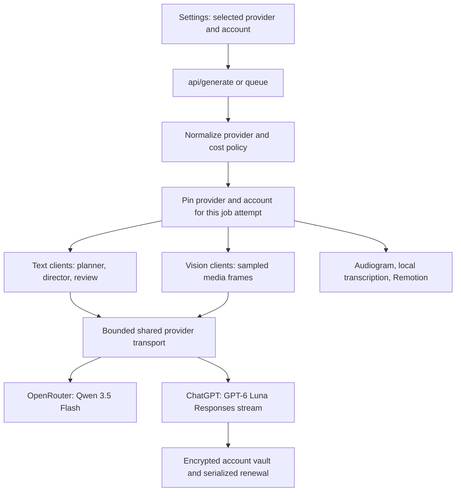

> Superseded: ChatGPT subscription sign-in and its UI/API routes are disabled. The current app uses Qwen through OpenRouter for manual jobs and a local external-agent inbox for agent jobs. See [AGENT_ACCESS.md](../AGENT_ACCESS.md). The details below describe the earlier gated prototype only.

# ChatGPT and OpenRouter provider integration

## What users select

Settings → AI provider offers:

- **ChatGPT — your subscription:** the selected user's eligible ChatGPT account
  powers scene planning, search-query planning, editorial direction, review,
  and image/frame vision through the official Responses API. GPT-6 Luna is the
  only exposed ChatGPT model. It must be in that account's current catalog.
- **OpenRouter:** the user's OpenRouter key powers text and vision requests.
  Efficient mode uses Qwen 3.5 Flash. Existing explicitly selected custom models
  remain supported. There is no automatic upgrade to an expensive model.

Users can add several separate ChatGPT registrations, including registrations
with the same email. Each has its own verified identity/client mapping and
encrypted token set. Switching is manual. New jobs use the chosen registration;
running attempts retain their original account. Account and app usage limits
are respected. A limit stops new inference on that account until the user
chooses another account or explicitly retries after checking usage.

ChatGPT plan sharing supports text and image inputs. It does not supply video
rendering, media downloads, speech synthesis, or transcription. ChatGPT mode
selects the existing Audiogram voice engine and keeps local transcription and
Remotion rendering. Media provider settings remain independent.

## Activation dependency

This implementation uses OpenAI's published **Sign in with ChatGPT** flow.
Identity sign-in alone is insufficient: the returned grant must include
`chatgpt.tokens.use.direct`.

OpenAI makes plan access available to open-source partners and selected private
clients. Vidnets is a private/commercial application. Personal ChatGPT accounts
do not remove the application's approval requirement. No owner subscription,
borrowed Codex client registration, ChatGPT session cookies, or unofficial web
endpoint is used.

For an approved public desktop client with the required plan scopes and loopback
callback registration, configure the backend's deployment environment:

```text
VIDNETS_CHATGPT_CLIENT_ID=<the issued oaiapp_ client ID>
VIDNETS_CHATGPT_PLAN_ACCESS_APPROVED=1
```

Verify these values against the actual approved client configuration before
distribution. A confidential website client is unsuitable for embedding a
client secret in an executable. The registered desktop callback must support
`http://127.0.0.1:<port>/auth/callback` with the flow's exact URI used in exchange.

For a distribution that actually qualifies as an open-source client:

```text
VIDNETS_CHATGPT_OPEN_SOURCE_CLIENT=1
```

That option enables the documented `dynamic_agent_client` registration flow.
It is **off by default**, and should not be enabled to bypass private-client
eligibility. No deployment approval flags were enabled during implementation.
Settings shows the activation requirement and disables initial sign-in until
one of these supported modes is configured.

## Wiring



- `server/services/provider_selection.py`: provider normalization, inexpensive
  defaults, and non-secret account handles for legacy planner interfaces.
- `server/services/chatgpt_accounts.py`: PKCE OAuth, loopback callback, verified
  ID tokens, account selection, DPAPI storage, refresh and revocation.
- `server/services/chatgpt_inference.py`: text/image conversion, Responses JSON
  contracts, event parsing and completed-response requirement.
- `server/services/bounded_http.py`: text and vision transport dispatch,
  concurrency limits, cancellation and wall budgets.
- `server/config.py` and `generation_cost_policy.py`: generation settings.
- `server/app.py`: local account endpoints, account-pinned generation context
  and explicit provider errors.
- `src/index.html` and `src/renderer.js`: provider settings, account controls,
  provider-aware generation checks and saved preferences.

The legacy `OpenRouterLLM` and `QwenVisionClient` class names remain compatible
with existing callers. They recognize non-secret ChatGPT account references;
the shared transport obtains the real OAuth bearer only inside the backend and
sends it solely to `https://api.openai.com/v1/responses`. A ChatGPT reference in
an OpenRouter job is rejected. A missing ChatGPT account cannot fall through to
an OpenRouter environment key.

The global vision queue now allocates clients per job attempt to avoid inheriting
the last project's account/provider. Structured caches include provider and
account identity. Optional Jev calls are disabled for ChatGPT jobs. Usage logs
identify subscription requests separately and do not infer an API dollar charge
from a ChatGPT subscription.

## Local account endpoints

| Endpoint | Purpose |
| --- | --- |
| `GET /api/chatgpt/status` | Public account labels, selected registration, integration status |
| `POST /api/chatgpt/connect` | Start new registration or reauthorize `account_id` |
| `POST /api/chatgpt/flow` | Read a sign-in attempt's status using `flow_id` |
| `POST /api/chatgpt/cancel` | Cancel an active sign-in attempt |
| `POST /api/chatgpt/select` | Select a saved registration; optional explicit `retry: true` |
| `POST /api/chatgpt/models` | Read the selected account's supported Luna catalog |
| `POST /api/chatgpt/disconnect` | Revoke refresh session and clear local tokens |

Endpoints are restricted to the local desktop and trusted local browser origin.
Mutations require JSON. Responses never expose access, refresh or ID tokens and
use `Cache-Control: no-store`. Authorization URLs containing ID-token hints
are opened from the backend, not saved or returned to renderer state.

## Credential and recovery behavior

- Credentials are protected with Windows DPAPI in the user's secure data
  directory (`chatgpt-accounts.dpapi`). No plaintext credential fallback is used.
- Fresh state, nonce, PKCE and a ten-minute transaction are used for each login.
  State is checked before exchange; callbacks are consumed once. A returning
  registration cannot be overwritten with another identity or issued client.
- ID-token signature, issuer, client audience, expiry and nonce are verified
  using PyJWT and OpenAI's fixed JWKS endpoint. Refresh identity is checked when
  a replacement ID token is present.
- Account refreshes are serialized with a cross-process file lock. Access and
  rotating refresh tokens are replaced atomically. Terminal refresh failures
  clear unusable tokens while retaining the account/client registration.
- Streams require `response.completed`; interrupted, failed, incomplete or
  limited responses never become partial edit plans.
- Permission/limit failures preserve the error code and request ID. They do
  not change account, model or billing provider. Interrupted transport attempts
  retain existing caller budgets and bounded transport retry behavior.
- Sign-out attempts revocation before deleting local tokens. If the network
  prevents confirmation, the UI tells the user to disconnect in ChatGPT Settings.

## Verification

The bundled Windows runtime passed 92 checks across the new provider suite and
existing OpenRouter routing, LLM client, generation configuration and editorial
brain suites. Provider tests use mocked official responses and real local DPAPI
and JWT signature verification. No paid inference was needed for those tests.

Live sign-in, entitlement and subscription inference remain unverified until
the private application's access is approved and an eligible user connects.
The existing installer was not rebuilt or deployed in this change.

## Official references

- [Integration availability](https://developers.openai.com/siwc/quickstart)
- [Desktop public-client sign-in](https://developers.openai.com/siwc/token-sharing-open-source/sign-in)
- [Accounts, renewal and usage](https://developers.openai.com/siwc/token-sharing-open-source/profiles-and-sessions)
- [Models and streaming inference](https://developers.openai.com/siwc/token-sharing-open-source/models-and-inference)
- [Supported capabilities and request limitations](https://developers.openai.com/siwc/token-sharing-open-source/preview-limitations)
- [Errors and recovery](https://developers.openai.com/siwc/token-sharing-open-source/errors-and-recovery)
